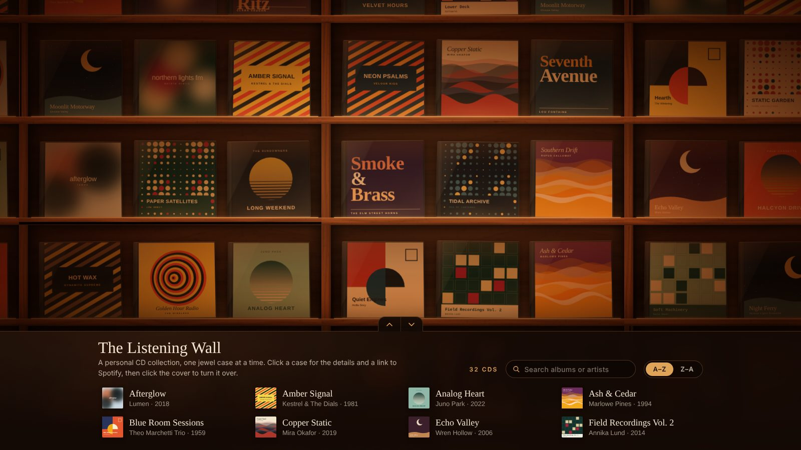
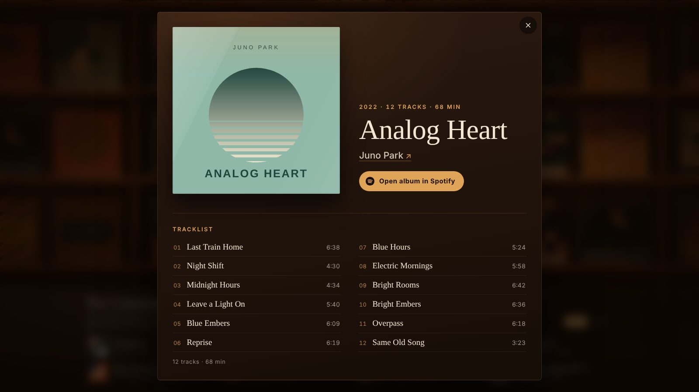

# The Listening Wall

An endless, softly lit wall of wooden shelves for showing off a CD collection.
Drag around the shelves, open a CD to see its details and tracklist, flip the case
to see the back, and jump to Spotify. Plain HTML, CSS and JavaScript: no build step,
no frameworks, no server.

*(Preview shows made-up sample albums. The template starts with 32 empty, numbered slots.)*

## Make your own

1. Click **Use this template → Create a new repository** at the top of this page.
2. Add your CDs (below).
3. Publish it: in your new repository go to **Settings → Pages**, set *Source* to
   **Deploy from a branch**, pick `main` and `/ (root)`, and save. After a minute your wall is live at
   `https://<your-username>.github.io/<repository-name>/`.

You can also just download the code and open `index.html` in a browser.

## Adding your CDs

`albums.js` holds 32 ready-made entries (AlbumNumber 1–32) with placeholder text.

1. Photograph each CD front and back, and name the photos by AlbumNumber:
   `covers/01-front.jpg`, `covers/01-back.jpg`, `covers/02-front.jpg` …
   (.jpg, .jpeg, .png or .webp; iPhone HEIC photos need exporting as JPG first).
2. In `albums.js`, replace the placeholders for that number: `AlbumName`, `ArtistName`, `AlbumDate`,
   `AlbumYear`, `NumberOfTracks`, `AlbumLength` and the track names (add or delete track lines as needed).
3. Optional: paste Spotify links into `SpotifyAlbumUrl` / `SpotifyArtistUrl` (blank = Spotify search).

Until a front photo is added, the wall shows an empty slot with the album number. Without a back photo,
the back of the case is made from the tracklist. For more than 32 CDs, copy the last entry and give it
the next AlbumNumber; for fewer, delete the spare entries. Photos around 1000px across keep the site fast.

## Make it yours

Everything adjustable lives in `config.js`:

- `FooterHeading` / `FooterText`: the name and intro shown in the footer
- `SortAlbumsBy`: `"Random"` (new order every visit), `"Manual"`, `"AlbumNumber"`, `"ArtistName"`, `"AlbumName"`, `"AlbumYear"`
- `CdsPerShelf`, `CubbiesAcross`: shelf layout
- `WoodTextureImage`: use a real wood photo for the shelves (e.g. `"textures/walnut.jpg"`)
- Movement and zoom feel, and CD size limits

Colours, lighting and fonts are at the top of `styles.css`. The page title is in `index.html`.

## Controls

- Move: drag, swipe, scroll wheel / trackpad, arrow keys or W A S D
- Zoom: pinch, or Ctrl / Cmd + scroll
- Click a CD: details, tracklist and Spotify links. Click the cover to flip the case
- Footer: full A–Z / Z–A list with search. The tab arrows (or a swipe) minimise, rest or expand it
- Keyboard: Tab to a CD, Enter opens it, Enter on the cover flips it, Esc closes

## Files

| File | What it is |
| --- | --- |
| `index.html` | Page structure |
| `styles.css` | The look: wood, lighting, cases, popup, footer |
| `app.js` | Layout, movement, zoom, popup and footer logic |
| `config.js` | Settings |
| `albums.js` | Your collection |
| `covers/` | Your front and back photos |
| `docs/` | Preview images for this README (safe to delete) |

## Licence

[PolyForm Noncommercial 1.0.0](LICENSE): free to use, change and share for any **non-commercial** purpose,
including your own personal collection site. Selling it, or using it for commercial purposes, is not allowed.
No credit is needed.
